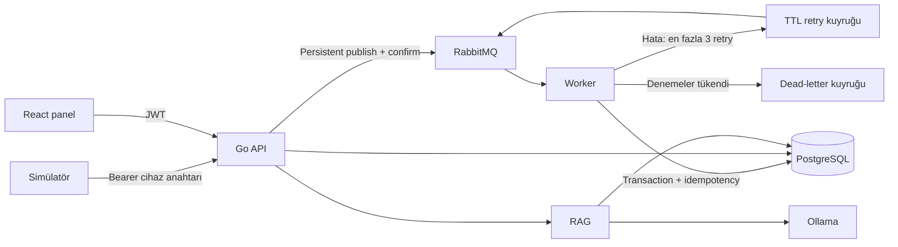

# Mimari kararlar

## Modüler monolith

`cmd/api`, `cmd/worker` ve `cmd/simulator` bağımsız process'lerdir. `internal/domain` olay doğrulama ve durum geçişlerini, `internal/platform` veritabanı/mesajlaşmayı, `internal/httpapi` HTTP/yetkilendirmeyi, `internal/assistant` RAG akışını içerir. SQL migration binary içine gömülüdür; API başlangıcında transaction ve advisory lock ile bir kez uygulanır.

## Teslim güvencesi

Hedef **en az bir kez teslim** ve **idempotent veritabanı etkisi**dir. Ağ kopmasında API publish sonucunu bilemeyebilir; istemci aynı olay kimliğiyle yeniden dener. Publisher confirm yalnızca kuyruğun mesajı kabul ettiğini belirtir, işlenmesini değil. Veritabanı commit'inden sonra ACK kaybolursa worker tekrar gelen kimliği no-op olarak işler.

Transaction önce olay kimliğine, sonra cihaz/hata anahtarına advisory lock alır. Böylece farklı consumer'lar aynı olayı veya açık arızayı yarışarak çoğaltmaz. `events.event_id` PK ve açık arızalar için partial unique index ikinci güvence katmanıdır. Retry yayını onaylanmadan orijinal ACK edilmez. Worker bağlantısının kapanması onaysız mesajı yeniden kuyruğa bırakır. Tek broker ve tek disk kullanımı broker kaybına karşı yüksek erişilebilirlik sağlamaz.

## RAG

Belge embedding işlemleri transaction dışında yapılır; tüm parçalar elde edildikten sonra belge ve vektörler tek transaction ile görünür olur. Model adı ve boyut uyumu aranır. İlk sürümde vektörler tam taranır; veri hacmi ve sabit embedding boyutu netleşince HNSW index eklenebilir. Kaynak kimliklerinin doğrulanması yalnızca referans bütünlüğünü korur; yanıtın kaynak tarafından desteklenmesi ayrıca değerlendirilecektir.

## Sınırlar

Modüller şu anda ortak veritabanını kullanır. HTTP query kodu doğrudan pgx çağırır; ihtiyaç arttığında repository katmanı ve sqlc üretimi ayrılabilir. Redis, birden fazla API örneğine geçerken ortak rate limit ve ölçülmüş cache ihtiyaçları için eklenebilir. Çok kurumlu kullanım bu şemada desteklenmez; tenant izolasyonu ayrıca tasarlanmalıdır.

## İş emri hiyerarşisi (v0.2)

Rol ve durum kararları `internal/domain/workflow.go` içinde merkezi bir politikayla doğrulanır. HTTP katmanı ilgili cihaz/hata için worker ile aynı advisory lock'u, ardından iş emrinin satır kilidini alır. Durum değişikliği, bağlı arızanın çözümü/yeniden açılması ve eski/yeni sorumluyla audit kaydı tek transaction içindedir. Teknisyen liste sorguları atanan kullanıcıya göre backend'de sınırlandırılır.

Yönetici atama ve son onaydan, teknisyen müdahaleden sorumludur. Bekleme gerekçesi ve devir talebi ayrı alanlardır; devir talebi işin durumunu veya sorumlusunu değiştirmez. Geri gönderme, aynı cihaz/hata için başka açık arıza olmadığında mümkündür. Migration 002 mevcut verilere yeni durum/alanları ekler.

## Onaylı bilgi aktarımı ve isteğe bağlı model

Teknisyen, atanmış arızasının `/similar` uç noktasından aynı hata kodundaki kapalı işlerin çözümünü ve yönetici onayını okuyabilir. Bu, başka teknisyenin tam iş emri/audit ekranına erişim vermez. `HistoricalSolutions` hem doğrudan görünümün hem de RAG geçmiş bağlamının ortak sorgusudur. Çözülmüş fakat yönetici tarafından kapatılmamış kayıtlar ortak kaynak yapılmaz.

Belge metni ve vektör indeksi ayrı yaşam döngülerindedir. `SaveDocument` başlık/içerik özeti üzerinden advisory lock alarak aynı metni tekrar eklemez. `IndexExisting` model çağrıları tamamlandıktan sonra transaction ile eski vektörleri değiştirir; model hatasında metin ve önceki indeks korunur. Kaynak belgeleri isteğe bağlı eğitim başlangıç aktarımıyla da yüklenebilir.

Embedding/generation servisi kapalıysa bakım asistanı `sources_only` modunda onaylı geçmiş kayıtları ve metninde hata kodu geçen belgeleri sunar. Bu yol vektör benzerliği veya LLM üretimi olarak adlandırılmaz. Model çıktısındaki uydurma kaynak, bozuk JSON veya boş öneri de güvenli kaynak görünümüne döner.

## Manuel bildirim ve olay kökeni

Elle girilen gözlemler ve kuyruktan gelen cihaz olayları `platform.applyEvent` transaction'ını paylaşır. Manuel yol düşük hacimli kullanıcı etkileşimi için senkrondur ve commit sonrasında arıza/iş emri kimliğini döndürür. Bu yol RabbitMQ'ya ikinci bir mesaj yayınlayarak aynı kaydı yeniden işlemeye çalışmaz. Otomatik yolun en az bir kez teslim / commit sonrası ACK güvencesi korunur.

Olaylar kaynak, bildiren kullanıcı, saha notu ve konum detayıyla saklanır. Yalnızca manuel olaylarda bildiren kullanıcı bulunmasını veritabanı CHECK ve FK kısıtları da doğrular. Kimlik body'den değil JWT oturumundan gelir. Manuel olay kimliği aktör ve istemci anahtarıyla adlandırılır; normalize edilmiş isteğin SHA-256 özeti aynı anahtarla farklı içerik gönderimini reddeder. Sunucunun varsayılan gözlem zamanı özete eklenmediği için boş tarihli tekrar denemeler de idempotent kalır.

Teknisyenin kendi bildirim listesi ile atanmış iş listesi ayrı erişim kurallarıdır. Bildirim listesi kendi gözlemi ve işin durumunu gösterir; tüm olay geçmişi hâlâ sorumlu teknisyen/yönetim erişimine bağlıdır. Manuel kayıt, mevcut açık arızayla birleştirilirken atama veya bakım durumu değiştirilmez.

## Geçmiş çözümlerde embedding bağımlılığı

Asistan, vektör araması öncesinde seçili embedding modeline ait parça bulunup bulunmadığını kontrol eder. Parça yoksa embedding modeli yüklenmez. Onaylı geçmiş kayıtlar ve hata koduyla tam metin eşleşmeleri varsa bunlarla doğrudan LLM üretimi yapılabilir. Bu, geçmiş çözüm paylaşımının doküman indeksleme modeline gereksiz bağımlılığını ve yerel ortamda gereksiz model geçişini kaldırır. Vektör araması kullanılamadığında ilişkisel kaynaklar korunur; model çağrı hataları teknik kaynakları veya kullanıcı iş akışını silmez.
